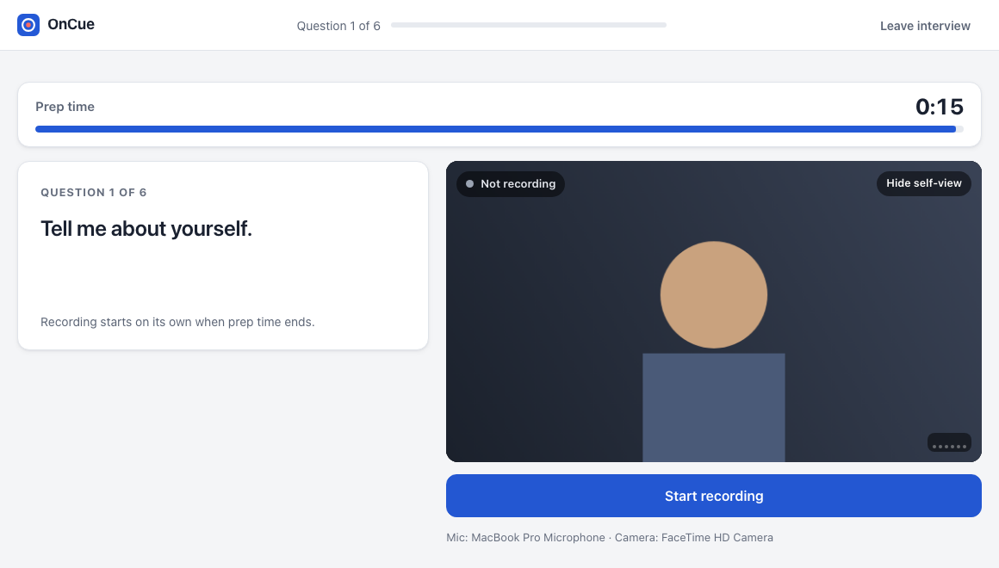
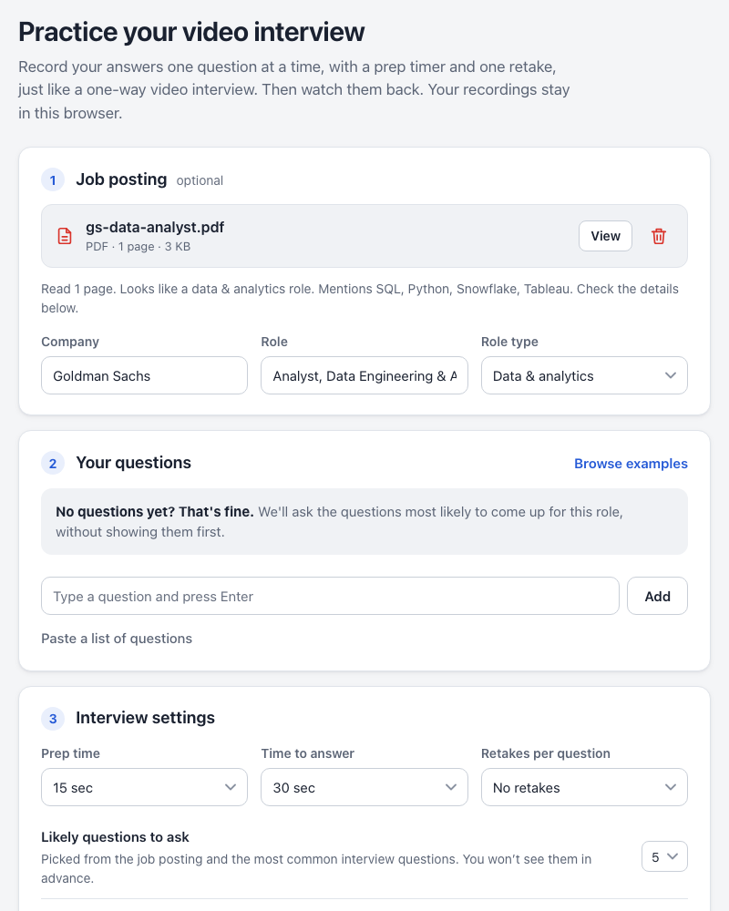
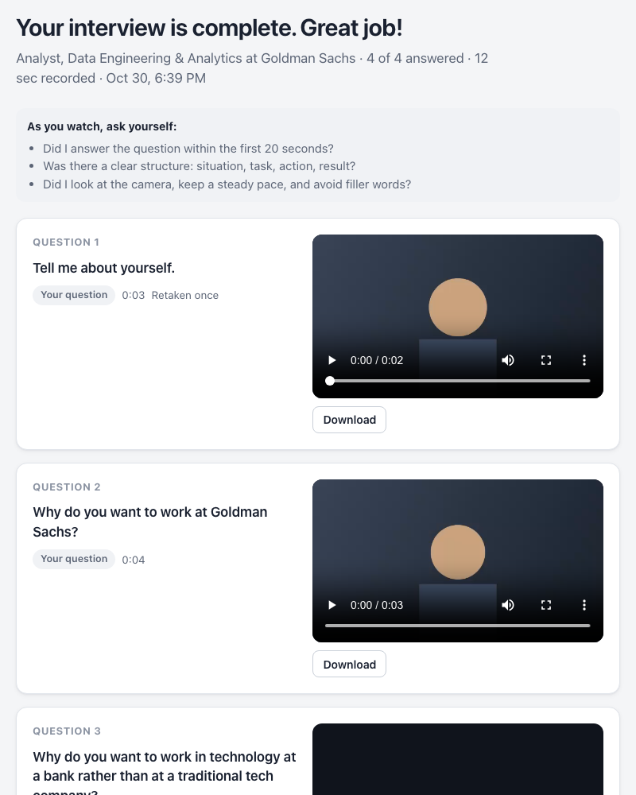

# OnCue

**Practice one-way video interviews (like HireVue) in your browser.** Add your questions, get a prep timer and one retake per question, face a surprise curveball, and watch your answers back.

[](https://davezagin-max.github.io/oncue/)
[](https://github.com/davezagin-max/oncue/actions/workflows/test.yml)
[](LICENSE)



<sub>The interview screen: read the question, use your prep time, and recording starts on its own after a 3-2-1.</sub>

## What it does

- **Times you like the real thing.** Each question gets prep time and an answer limit. Recording starts when prep ends and stops when time runs out. You get one retake per question (you can change this).
- **Lets you watch yourself back.** Every answer is saved in your browser so you can review it and download it, or delete the whole session.
- **Asks what you didn't prepare for.** Upload the job posting as a PDF and OnCue adds a hidden curveball question for that role. If you don't type any questions, it asks the ones most likely to come up.
- **Works with your headphones and mic.** Pick any camera, microphone, or speaker, including Bluetooth headsets and AirPods, check your mic level, and play a test sound.

## How it works

1. **Set up.** Upload the job posting (optional), type your questions or leave the list empty, and pick prep time, answer time and retakes.
2. **Check your camera and mic.** Choose devices, watch the mic level move, play a test sound, record a 5-second test clip, and try an unscored practice question.
3. **Interview.** One question at a time, the way one-way interviews run it: the question with a prep countdown ("Not recording"), a 3-2-1, then recording with a time limit. Watch the take, then re-record (if you have a retake left) or move to the next question. You can hide your own video if it distracts you.
4. **Review.** Watch every answer, see which questions were likely picks or the curveball (and why each was chosen), and download the videos.

| Set up | Watch your answers back |
| --- | --- |
|  |  |

## Interview codes: let someone else pick the questions

Practicing is more realistic when you can't see the questions coming. A friend, parent or mentor builds the interview on the **[Make an interview code](https://davezagin-max.github.io/oncue/setter.html)** page and sends you a code that starts with `HV1-`. Paste it under **Got an interview code?** on the setup page.

**Making a code** takes a minute, with no account and nothing uploaded:

- **Pick questions** from the example groups (most common, behavioral, motivation, curveball-style, questions for 23 role types, and reported Goldman Sachs questions), from an example Goldman Sachs Operations interview with target times, or type your own in any language.
- **Set the order** (random, or the order you choose) and an optional **target time** for each answer.
- **Set the rules:** prep time, answer limit, one take or retakes, and a name for the interview.
- **Copy the code,** or a ready-to-text message with the link and the code.
- **Nothing lingers.** Your choices are kept only in that browser tab, and **Start over** clears them, so the person you made it for can't open the page later on the same computer and read the questions.

**Taking the interview:**

- **Before you start,** you see only the interview's name, how many questions it has, the prep and answer times, and whether retakes are allowed. Each question appears only when it's asked.
- **The interview runs on the code's settings:** prep time, answer limit, one take or retakes ("Use this answer" or "Retake"), and the question order. A random order is shuffled once and kept.
- **Leave or close the tab, and the interview stays open.** Resume it from Past practice sessions: it picks up at the next unanswered question, in the same order, and asks the question you were on again.
- **The review shows how long you spoke against each question's target time:** green within 10 seconds, amber 10 to 20 seconds over, red more than 20 over, always with the difference in words.
- **Each code is taken once.** To practice again, ask for a new code.

A code is the interview compressed and scrambled, with a checksum so a cut-off code is caught. That hides the questions from a glance, but it is not encryption. [`js/code.js`](js/code.js) reads it.

## How questions are picked

OnCue reads the job posting in your browser and looks for:

- **The role type** (24 families, from data and software to nursing and teaching), weighted toward the job title.
- **What the posting stresses**, such as teamwork, attention to detail or working under pressure, and the tools it names (SQL, Python, Excel and so on).
- **The company and job title**, which fill in questions like "Why do you want to work at …?". You can edit both.

From that it fills a few priority slots (opener, why this company, why this role, the posting's top skills, a role-specific question, a classic like "tell me about a failure") and avoids near-duplicates of anything you typed. The curveball comes from a pool for the role and industry, never repeats your questions, and never comes first.

**Goldman Sachs examples.** The "Browse examples" library includes 70+ questions that candidates report from Goldman Sachs HireVue interviews (2018–2026), each linked to where it was reported in [`js/bank-goldman.js`](js/bank-goldman.js). Reported format: usually 5–6 questions, about 30 seconds to prepare, and up to 2 minutes to answer (some 2026 reports say 90 seconds). Most candidates say there is one take per question, so try a round with retakes set to "No retakes" before the real thing.

## Privacy

Everything runs in your browser. Recordings and the job posting are stored only in this browser (IndexedDB) and are never uploaded. The only network request loads [pdf.js](https://mozilla.github.io/pdf.js/) (a pinned version, from jsDelivr) when you upload a PDF, to read its text. Delete any session from the review screen or the home page. Safari may clear site data after a few weeks without a visit, so download any answers you want to keep.

## Browser support

Current Chrome, Edge, Firefox and Safari on desktop. Phones work for practice too.

- **Choosing a speaker** (for example, sending playback to AirPods) works in Chrome, Edge and Firefox. Safari plays through your system's current output, so pick your headphones in the Mac's Control Center.
- **Bluetooth microphones** work everywhere, but many headsets switch to lower "call quality" sound while their mic is on. Your laptop's mic often sounds better on the recording.
- **Recordings** save as MP4 where the browser supports it (Safari, recent Chrome and Edge) and WebM otherwise (Firefox).

## Run locally

No build step and no dependencies. Serve the folder over `http://localhost` (browsers only allow the camera on `https://` or `localhost`):

```bash
python3 -m http.server 8642
```

Then open <http://localhost:8642>.

## Tests

The question engine and the code reader are plain JavaScript with Node tests:

```bash
npm test
```

## Project structure

```
index.html          the four screens: setup, device check, interview, review
setter.html         "Make an interview code": build an interview for someone else
js/setter.js        picks questions, order, targets and rules, and makes the code
css/styles.css      all styling (light and dark)
js/app.js           wires the screens together
js/setup.js         job posting upload, your questions, settings, past sessions
js/check.js         camera, microphone and speaker check (Bluetooth included)
js/interview.js     prep countdown, recording, retakes, submit
js/review.js        watch, download and delete answers; spoken time against targets
js/code.js          reads interview codes (HV1-…) from the Interview Setter
js/engine.js        reads the posting, picks likely questions and the curveball
js/bank.js          competencies, skills, industries and common questions
js/bank-roles-*.js  likely questions and curveballs for 24 role types
js/bank-goldman.js  questions reported from Goldman Sachs HireVue interviews, with sources
js/library.js       the "Browse examples" dialog
js/media.js         device lists, recording, mic level, speaker routing
js/storage.js       IndexedDB storage for sessions, recordings and the posting
js/posting.js       PDF text extraction with pdf.js
tests/              engine and code tests, sample job postings, a sample code
```

## Disclaimer

OnCue is an independent practice tool. It is not affiliated with, endorsed by, or connected to HireVue, Goldman Sachs, or any employer. "HireVue" is a trademark of its owner and is used here only to describe the kind of interview this helps you practice for. Reported questions come from public prep sites and candidate posts; real interviews vary.

## License

[MIT](LICENSE)
